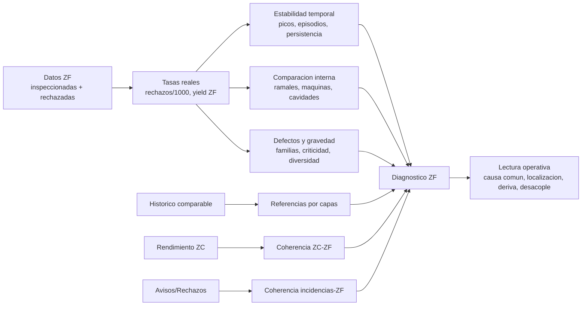
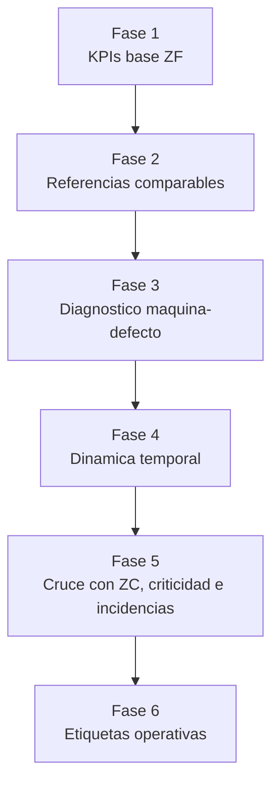

# Plan de analisis de estabilidad de maquinas de inspeccion ZF

## 1. Resumen ejecutivo

Este modulo busca analizar las maquinas de inspeccion de zona fria (ZF) desde dos
puntos de vista complementarios:

1. **Calidad real observada en ZF**: cuantas botellas pasan, cuantas se rechazan,
   con que tasa, en que ramal, cavidad, turno, dia o produccion.
2. **Comportamiento de la maquina como sistema de deteccion**: si una maquina se
   separa de su historico, del resto de maquinas o de su comportamiento habitual
   para un defecto concreto.

La diferencia es importante:

```text
Calidad ZF:
  "La produccion tuvo una tasa de rechazo alta."

Comportamiento de maquina:
  "La maquina ZF-2 detecto el defecto X por encima de su historico comparable
   y de forma distinta al resto de maquinas."
```

El modulo no debe afirmar causas automaticamente. Debe generar evidencias para
formular hipotesis:

- problema real de fabricacion;
- problema localizado en ramal/cavidad;
- comportamiento comun de proceso;
- posible sensibilidad/configuracion de una maquina;
- desacople entre fuentes de datos.

## 2. Preguntas que debe responder

El modulo debe ayudar a responder preguntas de produccion y calidad:

```text
1. Esta produccion rechazo mas en ZF que otras producciones comparables?
2. La subida es general o esta concentrada en un ramal/maquina/cavidad?
3. Los rechazos son estables, persistentes, intermitentes o en rafagas?
4. Una maquina concreta se separa del comportamiento del resto?
5. Un defecto concreto aparece mas de lo habitual en una maquina?
6. El rechazo ZF coincide con caidas de rendimiento ZC?
7. Los defectos rechazados son criticos/graves o principalmente leves?
8. Lo que detecta la maquina coincide con avisos/rechazos registrados?
9. El patron parece causa comun o comportamiento local de inspeccion?
```

## 3. Esquema conceptual



## 4. Datos esperados

La tabla futura deberia contener informacion por ventana temporal. La granularidad
base recomendada es 10 minutos, agregable a hora, turno, dia y produccion.

### 4.1 Campos minimos

| Campo | Descripcion |
|---|---|
| timestamp_inicio | Inicio de la ventana temporal |
| timestamp_fin | Fin de la ventana temporal |
| linea | AV23, AV32, etc. |
| ramal | Ramal dentro de la linea |
| maquina_inspeccion | Identificador de maquina ZF |
| cavidad | Cavidad, si esta disponible |
| botellas_inspeccionadas | Botellas que pasan por inspeccion ZF |
| botellas_rechazadas | Botellas rechazadas por inspeccion ZF |
| defecto | Codigo de defecto, si esta disponible |
| familia_defecto | Familia o descripcion del defecto |
| gravedad | Critico, Grave, Mayor, Menor, Leve, si existe mapeo |

### 4.2 Campos adicionales muy recomendables

Estos campos no son imprescindibles para empezar, pero son muy valiosos para
distinguir problema de producto frente a comportamiento de inspeccion:

| Campo | Valor analitico |
|---|---|
| receta_inspeccion | Permite comparar contra configuraciones equivalentes |
| version_receta | Evita comparar historicos con recetas distintas |
| modo_auto_manual | Distingue inspeccion automatica de intervenciones |
| estado_maquina | Ayuda a contextualizar paradas o modos degradados |
| cambio_configuracion | Marca posibles rupturas de comparabilidad |
| vista/camara | Localiza problemas de camara o iluminacion |
| score_defecto | Permite analizar cercania al umbral de rechazo |
| umbral_defecto | Permite diferenciar defecto claro de caso limite |
| operador/turno | Util para sesgos de turno si aplica |

Si algun campo no existe, el sistema debe seguir funcionando y marcar menor
confianza en las interpretaciones que dependan de el.

## 5. Capas de analisis

El modulo debe separarse en tres capas. Esta separacion evita mezclar conceptos.

```text
Capa 1. Calidad ZF de la produccion
  Tasas reales, yield, rechazos por 1000, estabilidad temporal.

Capa 2. Comportamiento de maquinas de inspeccion
  Maquina vs historico, maquina vs resto, maquina-defecto, deriva, desacople.

Capa 3. Coherencia con otras fuentes
  Rendimiento ZC, criticidad, avisos/rechazos, turnos, ramales.
```

La primera version puede empezar por la Capa 1. La Capa 2 es la que aporta el
mayor valor diferencial para entender si una maquina se comporta de forma
especial. La Capa 3 ayuda a construir una explicacion industrial.

## 6. Referencias comparables en capas

El plan original analizaba estabilidad y comparacion, pero faltaba definir con
precision contra que historico se compara cada senal. Se recomienda usar
referencias jerarquicas.

### 6.1 Referencia global del modelo

```text
referencia_global_modelo =
  historico del mismo modelo de botella
  considerando todas las maquinas
  considerando todos los defectos
```

Pregunta:

```text
Esta produccion se comporta peor que lo habitual para este modelo?
```

Uso:

- lectura general de lote/produccion;
- ranking de producciones;
- comparacion con historico comparable.

### 6.2 Referencia modelo + defecto

```text
referencia_modelo_defecto =
  historico del mismo modelo de botella
  filtrado por defecto
```

Pregunta:

```text
Este defecto aparece mas de lo habitual para este modelo?
```

Uso:

- detectar familias de defecto anormalmente presentes;
- separar "rechazo alto por defecto habitual" de "rechazo alto por defecto raro".

### 6.3 Referencia modelo + maquina

```text
referencia_modelo_maquina =
  historico del mismo modelo de botella
  filtrado por maquina de inspeccion
```

Pregunta:

```text
Esta maquina rechaza mas de lo habitual cuando inspecciona este modelo?
```

Uso:

- detectar maquinas que se separan de su propia referencia;
- comparar una maquina consigo misma, no solo contra otras.

### 6.4 Referencia modelo + maquina + defecto

```text
referencia_modelo_maquina_defecto =
  historico del mismo modelo de botella
  filtrado por maquina
  filtrado por defecto
```

Pregunta:

```text
La maquina X detecta el defecto Y mas de lo habitual para este modelo?
```

Uso:

- diagnostico fino maquina-defecto;
- detectar desviaciones especificas;
- diferenciar causa comun frente a comportamiento local.

### 6.5 Cobertura minima de referencia

Cada referencia debe informar cobertura:

```text
n_producciones_historicas
n_ventanas_historicas
botellas_historicas_inspeccionadas
rechazos_historicos
```

Si la cobertura es baja, la lectura debe mostrarse como provisional.

Ejemplo:

```text
Referencia modelo + maquina + defecto basada en solo 2 producciones historicas.
Interpretar desviacion con cautela.
```

## 7. Metricas base de calidad ZF

La metrica fundamental es la tasa real de rechazo ZF.

```text
tasa_rechazo_zf = botellas_rechazadas / botellas_inspeccionadas
```

Para planta, suele ser mas claro expresarla por 1.000 botellas:

```text
rechazos_por_1000 = 1000 * botellas_rechazadas / botellas_inspeccionadas
```

Y como rendimiento:

```text
yield_zf = 1 - tasa_rechazo_zf
```

Estas metricas deben calcularse por:

- produccion;
- linea;
- ramal;
- maquina;
- cavidad;
- defecto;
- gravedad;
- turno;
- dia.

Lectura:

- tasa alta: mayor rechazo real en ZF;
- yield bajo: peor rendimiento en inspeccion;
- rechazos por 1000: lectura operativa directa;
- comparacion por ramal/maquina: localiza desequilibrios.

## 8. Estabilidad temporal

No basta con una media. Dos producciones pueden tener la misma tasa media y
patrones muy diferentes.

Metricas recomendadas:

```text
media_tasa_rechazo
mediana_tasa_rechazo
P90_tasa_rechazo
P95_tasa_rechazo
MAD_tasa_rechazo
IQR_tasa_rechazo
coeficiente_variacion_robusto = MAD / max(mediana, epsilon)
```

Lectura:

- mediana alta: nivel habitual alto;
- P95 alto: ventanas extremas;
- MAD/IQR alto: variabilidad;
- coeficiente robusto alto: inestabilidad relativa.

La mediana y el MAD deben priorizarse frente a media y desviacion tipica cuando
existan picos.

## 9. Episodios anomalos

Se deben identificar periodos donde la tasa ZF se aleja de su referencia.

Referencia robusta:

```text
centro = mediana(tasa_rechazo_zf)
sigma_robusta = 1.4826 * MAD(tasa_rechazo_zf)
umbral_alto = centro + k * sigma_robusta
```

Con `k = 3` como punto de partida.

Ventana anomala:

```text
tasa_rechazo_zf > umbral_alto
```

Indicadores:

```text
porcentaje_ventanas_anomalas
numero_episodios_anomalos
duracion_maxima_episodio_anomalo
duracion_mediana_episodio_anomalo
tiempo_total_en_estado_alto
```

Lectura:

- muchos episodios cortos: intermitencia;
- pocos episodios largos: persistencia;
- episodios sincronizados entre maquinas: posible causa comun;
- episodios aislados en una maquina: posible condicion local.

## 10. Persistencia e intermitencia

Ejemplo:

```text
Caso A: 1 episodio de 120 min
Caso B: 8 episodios de 15 min
```

Ambos suman 120 min, pero no significan lo mismo.

Metricas:

```text
persistencia = mediana(duracion_episodios_altos)
persistencia_maxima = max(duracion_episodio_alto)
intermitencia = numero_episodios_altos / horas_produccion
tiempo_estado_alto = minutos_estado_alto / minutos_produccion
```

Lectura:

- persistencia alta: problema sostenido;
- intermitencia alta: problema recurrente;
- ambos altos: problema recurrente y duradero.

## 11. Consistencia entre ramales y maquinas

Para cada ventana, turno, dia o produccion:

```text
tasa_i = rechazos_i / inspeccionadas_i
spread = max(tasa_i) - min(tasa_i)
ratio_peor_mejor = (max(tasa_i) + epsilon) / (min(tasa_i) + epsilon)
```

Indicadores:

- diferencia media entre ramales/maquinas;
- diferencia P95;
- porcentaje de ventanas con spread alto;
- maquina o ramal peor de forma sostenida;
- correlacion temporal entre maquinas.

Lectura:

- todas las maquinas suben: posible causa comun;
- una maquina sube: posible condicion local;
- un ramal siempre peor: sesgo estructural o proceso localizado;
- picos alternos: inestabilidad o ruido.

## 12. Consistencia por cavidad

Si existe informacion por cavidad:

```text
tasa_rechazo_cavidad = rechazos_cavidad / inspeccionadas_cavidad
```

Concentracion Top 3:

```text
top3_cavidades = rechazo_top3_cavidades / rechazo_total
```

HHI de cavidades:

```text
HHI_cavidades = sum(cuota_i^2)
cuota_i = rechazo_cavidad_i / rechazo_total
```

Lectura:

- HHI alto: pocas cavidades concentran el rechazo;
- HHI bajo: rechazo repartido;
- Top 3 alto + HHI alto: problema muy localizado;
- Top 3 bajo + HHI bajo: problema sistemico/disperso.

## 13. Diversidad de defectos

HHI de defectos:

```text
HHI_defectos = sum(cuota_defecto_i^2)
```

Diversidad:

```text
diversidad_defectos = 1 - HHI_defectos
```

Lectura:

- diversidad baja: pocos defectos explican casi todo;
- diversidad alta: muchos defectos contribuyen;
- diversidad alta + tasa alta: diagnostico mas dificil;
- diversidad baja + tasa alta: problema mas accionable.

Debe calcularse:

- global por produccion;
- por maquina;
- por ramal;
- por cavidad;
- por turno;
- por gravedad.

## 14. Desviacion maquina-defecto

El anexo proponia "sobredeteccion". El concepto es valioso, pero conviene usar
un lenguaje mas neutro al principio:

```text
desviacion maquina-defecto
```

Motivo:

```text
La maquina detecta mas ese defecto, pero aun no sabemos si es por sensibilidad,
configuracion o porque realmente recibe mas defecto.
```

### 14.1 Ratio de desviacion

```text
ratio_desviacion_maquina_defecto =
  tasa_actual_maquina_defecto
  /
  mediana_historica_maquina_defecto_mismo_modelo
```

Lectura:

```text
La maquina detecta ese defecto X veces por encima de su referencia comparable.
```

### 14.2 Z robusto

```text
z_robusto_maquina_defecto =
  (tasa_actual_maquina_defecto - mediana_historica_maquina_defecto)
  /
  max(MAD_historico_maquina_defecto, epsilon)
```

Lectura:

```text
La maquina esta fuera de su variabilidad historica normal para ese defecto.
```

### 14.3 Exceso absoluto por 1.000 botellas

```text
exceso_absoluto_por_1000 =
  tasa_actual_por_1000_maquina_defecto
  -
  mediana_historica_por_1000_maquina_defecto
```

Esto evita sobrerreaccionar a ratios grandes con impactos pequenos.

Ejemplo:

```text
Historico: 0.1 rechazos / 1000
Actual:    0.4 rechazos / 1000
Ratio:     x4
Exceso:    +0.3 rechazos / 1000
```

El ratio es alto, pero el exceso absoluto es pequeno.

### 14.4 Regla de lectura conjunta

No se debe priorizar solo por ratio. La lectura minima debe combinar:

```text
ratio_desviacion
z_robusto
exceso_absoluto_por_1000
volumen_inspeccionado
numero_rechazos
```

## 15. Comparacion simultanea entre maquinas para el mismo defecto

Para cada defecto:

```text
tasa_m1_defecto_x
tasa_m2_defecto_x
tasa_m3_defecto_x
...
```

Metricas:

```text
spread_maquinas_defecto =
  max(tasa_maquina_defecto) - min(tasa_maquina_defecto)
```

```text
ratio_peor_mejor_maquina_defecto =
  (max(tasa_maquina_defecto) + epsilon)
  /
  (min(tasa_maquina_defecto) + epsilon)
```

HHI de maquinas para un defecto:

```text
HHI_maquinas_defecto = sum(cuota_maquina_i^2)

cuota_maquina_i =
  rechazos_maquina_i_defecto
  /
  rechazos_totales_defecto
```

Lectura:

- HHI alto: una maquina concentra el defecto;
- HHI bajo: defecto repartido entre maquinas;
- subida simultanea en todas: posible causa comun;
- subida en una sola: posible condicion local.

## 16. Dinamica temporal de maquina

### 16.1 Pendiente global de maquina

```text
pendiente_maquina =
  slope(tasa_rechazo_maquina ~ tiempo)
```

Lectura:

- positiva: empeora;
- negativa: mejora o se estabiliza;
- cercana a cero: estable.

### 16.2 Pendiente maquina-defecto

```text
pendiente_maquina_defecto =
  slope(tasa_defecto_x_maquina_y ~ tiempo)
```

Permite detectar cambios de composicion:

```text
El rechazo total se mantiene estable, pero el defecto X sube y el defecto Y baja.
```

### 16.3 Pendiente relativa frente al resto

```text
pendiente_relativa_maquina =
  slope(
    tasa_maquina_x - mediana_tasa_resto_maquinas
    ~ tiempo
  )
```

Esta es la mas util para detectar desacople:

```text
La maquina X se separa progresivamente del resto.
```

## 17. Arranque, estabilizacion y degradacion final

Un arranque malo que se corrige no debe interpretarse igual que una deriva
progresiva.

### 17.1 Indice de arranque

```text
indice_arranque_maquina =
  tasa_rechazo_primer_tramo
  /
  tasa_rechazo_tramo_central
```

### 17.2 Indice de arranque relativo

```text
indice_arranque_relativo =
  indice_arranque_maquina
  /
  mediana_indice_arranque_resto_maquinas
```

### 17.3 Indice de degradacion final

```text
indice_degradacion_final =
  tasa_rechazo_ultimo_tramo
  /
  tasa_rechazo_tramo_central
```

Tramos recomendados:

```text
Modo fijo:
  primeros 60 min / tramo central / ultimos 60 min

Modo relativo:
  primer 20% / tramo central 60% / ultimo 20%
```

El modo relativo es mas robusto para producciones cortas.

## 18. Intensidad acumulada y exceso sobre esperado

La duracion de un episodio alto no indica si esta ligeramente por encima del
umbral o muy por encima. Por eso conviene medir intensidad.

### 18.1 Area de exceso sobre umbral

```text
AUC_exceso =
  suma(
    max(0, tasa_t - umbral)
    * duracion_ventana
  )
```

Lectura:

```text
Cuanta intensidad temporal de rechazo anomalo acumula la maquina.
```

### 18.2 Exceso acumulado de rechazos

```text
exceso_rechazos_ventana =
  max(0, tasa_actual_t - tasa_esperada_t)
  * botellas_inspeccionadas_t
```

```text
exceso_rechazos_total =
  suma(exceso_rechazos_ventana)
```

Lectura:

```text
La maquina genero aproximadamente 240 rechazos por encima de lo esperado.
```

Esta metrica es muy defendible porque convierte anomalia estadistica en impacto
industrial.

## 19. Concentracion temporal y rafagas

### 19.1 Concentracion en peores ventanas

```text
concentracion_temporal_top10 =
  rechazos_en_top_10pct_ventanas
  /
  rechazos_totales
```

Lectura:

```text
El 62% del rechazo se concentro en el 10% de las peores ventanas.
```

### 19.2 Indice de rafaga

```text
indice_rafaga =
  P95_tasa_rechazo
  /
  max(mediana_tasa_rechazo, epsilon)
```

Lectura:

- alto: picos fuertes;
- cercano a 1: comportamiento uniforme;
- alto en una maquina: inestabilidad local;
- alto en todas: posible causa comun.

Debe tratarse como diagnostico secundario, no como indicador principal.

## 20. Autocorrelacion y correlacion cruzada

Estas metricas son utiles, pero deben considerarse avanzadas.

### 20.1 Autocorrelacion

```text
autocorrelacion_lag1 =
  corr(tasa_t, tasa_t-1)
```

Lectura:

- alta: la maquina tiene memoria temporal;
- baja: picos aislados.

### 20.2 Correlacion entre maquinas

```text
correlacion_maquina_i_j =
  corr(tasa_maquina_i_t, tasa_maquina_j_t)
```

Lectura:

- alta: maquinas se mueven juntas;
- baja: comportamiento desacoplado.

### 20.3 Correlacion con desfase

```text
correlacion_lag_k =
  corr(tasa_maquina_i_t, tasa_maquina_j_t-k)
```

Solo debe usarse cuando la sincronizacion temporal este validada.

## 21. Etiquetas operativas de maquina

No se recomienda empezar con un score cerrado de "maquina mala". Es mas
interpretable usar etiquetas respaldadas por evidencias.

Etiquetas sugeridas:

```text
Maquina coherente con el resto
Desviacion puntual maquina-defecto
Arranque inestable corregido
Deriva progresiva
Maquina desacoplada del resto
Maquina dominante en defecto concreto
Causa comun probable entre maquinas
```

Ejemplo de regla:

```text
Etiqueta sugerida si se cumplen al menos 3 evidencias de 5.
```

Evidencias posibles:

- ratio de desviacion alto;
- z robusto alto;
- exceso absoluto relevante;
- pendiente relativa positiva;
- HHI maquinas-defecto alto;
- baja correlacion con el resto;
- patron no replicado en otras maquinas.

## 22. Cruce con rendimiento de zona caliente

El cruce ZC-ZF ayuda a separar fabricacion de inspeccion.

| Situacion | Lectura |
|---|---|
| ZC bajo + ZF alto | deterioro real probable de fabricacion |
| ZC normal + ZF alto | posible problema ZF, sensibilidad o defecto no capturado en ZC |
| ZC bajo + ZF normal | perdida en caliente sin impacto claro en rechazo frio |
| ZC normal + ZF normal | produccion estable |

Mapa recomendado:

```text
X = rendimiento ZC medio
Y = tasa rechazo ZF
Tamaño = botellas inspeccionadas
Color = dispersion cavidades o criticidad
```

## 23. Cruce con criticidad de defectos

Metricas por gravedad:

```text
tasa_critico = rechazos_criticos / inspeccionadas
tasa_grave = rechazos_graves / inspeccionadas
tasa_critico_grave =
  (rechazos_criticos + rechazos_graves) / inspeccionadas
porcentaje_critico_grave =
  rechazos_criticos_graves / rechazos_totales
```

Lectura:

```text
Produccion A: rechazo alto, pero dominado por leves.
Produccion B: rechazo medio, pero con alto peso critico/grave.
```

La produccion B puede ser mas preocupante desde calidad cliente.

## 24. Cruce con avisos y rechazos registrados

Comparar ZF con avisos/rechazos ayuda a validar coherencia entre fuentes.

### 24.1 Pendientes comparadas

```text
pendiente_maquina_defecto
vs
pendiente_avisos_rechazos_defecto
```

Lecturas:

```text
Ambas suben:
  deteccion de maquina e incidencias evolucionan de forma coherente.

Maquina sube, avisos/rechazos no:
  posible desacople, sensibilidad local o defecto no registrado igual.

Avisos/rechazos suben, maquina no:
  posible falta de captura por maquina o diferencia entre fuentes.
```

### 24.2 Correlacion temporal

```text
correlacion_maquina_avisos_defecto =
  corr(tasa_maquina_defecto_t, tasa_avisos_rechazos_defecto_t)
```

Puede analizarse con desfase solo si la sincronizacion temporal esta controlada.

## 25. Visualizaciones recomendadas

### 25.1 Vista resumen de produccion

Tarjetas:

- botellas inspeccionadas;
- rechazos ZF;
- rechazos por 1.000;
- yield ZF;
- P95 tasa rechazo;
- porcentaje de ventanas anomalas;
- peor ramal/maquina;
- Top 3 cavidades;
- tasa critico+grave.

### 25.2 Evolucion temporal

- tasa rechazo ZF por maquina/ramal;
- rendimiento ZC superpuesto;
- episodios anomalos;
- fondos por turno;
- cambios sostenidos.

### 25.3 Matriz maquina x defecto

```text
filas = maquinas
columnas = defectos
color = z_robusto o exceso absoluto
```

Permite ver rapidamente que maquina y que defecto se salen.

### 25.4 Maquina vs resto

```text
linea 1 = tasa maquina seleccionada
linea 2 = mediana resto de maquinas
linea 3 = diferencia maquina - resto
```

Muy util para detectar separacion progresiva.

### 25.5 Ranking de maquinas desacopladas

Columnas:

```text
maquina
defecto
ratio_desviacion
z_robusto
exceso_absoluto_por_1000
pendiente_relativa
HHI_maquinas_defecto
correlacion_con_resto
etiqueta_diagnostico
```

### 25.6 Curva de exceso acumulado

```text
X = tiempo
Y = exceso acumulado de rechazos sobre esperado
```

Muestra cuando se genera el impacto principal.

### 25.7 Arranque y degradacion por maquina

Graficos:

- indice de arranque por maquina;
- indice de arranque relativo;
- indice de degradacion final;
- comparacion primer tramo / central / final.

## 26. Textos operativos automaticos

Ejemplos:

```text
La maquina ZF-2 detecta el defecto X 3.5 veces por encima de su historico
comparable para este modelo.
```

```text
El defecto X se concentra principalmente en la maquina ZF-2, que acumula el 68%
de las detecciones del defecto durante la produccion.
```

```text
La maquina ZF-3 presenta pendiente positiva mientras la mediana del resto de
maquinas permanece estable. Patron compatible con deriva local o condicion
especifica del ramal.
```

```text
Las maquinas muestran una subida sincronizada del defecto Y. El patron es mas
compatible con causa comun de proceso que con desajuste individual.
```

```text
La deteccion de la maquina ZF-2 aumenta, pero los avisos/rechazos registrados no
muestran tendencia equivalente. Conviene revisar posible desacople entre fuentes.
```

## 27. KPIs prioritarios para primera version

Primera version:

1. `rechazos_por_1000`.
2. `yield_zf`.
3. `P95_tasa_rechazo_zf`.
4. `% ventanas anomalas`.
5. `spread_entre_maquinas/ramales`.
6. `ratio_peor_mejor_maquina`.
7. `concentracion_top3_cavidades`.
8. `HHI_cavidades`.
9. `tasa_critico_grave_por_1000`.
10. `correlacion_rendimiento_zc_vs_rechazo_zf`.

Segunda version:

1. `ratio_desviacion_maquina_defecto`.
2. `z_robusto_maquina_defecto`.
3. `exceso_absoluto_por_1000`.
4. `HHI_maquinas_defecto`.
5. `pendiente_relativa_maquina`.
6. `indice_arranque_maquina`.
7. `indice_degradacion_final`.
8. `exceso_rechazos_total`.

## 28. Priorizacion por fases



### Fase 1. KPIs base ZF

- tasas reales;
- rechazos por 1.000;
- yield ZF;
- P95;
- ventanas anomalas;
- ramales/cavidades.

### Fase 2. Referencias comparables

- modelo;
- modelo + defecto;
- modelo + maquina;
- modelo + maquina + defecto.

### Fase 3. Diagnostico maquina-defecto

- ratio;
- z robusto;
- exceso absoluto;
- HHI maquinas-defecto;
- matriz maquina x defecto.

### Fase 4. Dinamica temporal

- pendientes;
- arranque;
- degradacion final;
- concentracion temporal;
- AUC/exceso acumulado.

### Fase 5. Coherencia entre fuentes

- ZF vs ZC;
- ZF vs criticidad;
- ZF vs avisos/rechazos.

### Fase 6. Etiquetas operativas

- coherente;
- desviacion puntual;
- arranque inestable;
- deriva progresiva;
- maquina desacoplada;
- causa comun probable.

## 29. Precauciones

### 29.1 Historico insuficiente

Las referencias especificas pueden tener poco dato. Se debe informar cobertura.

### 29.2 Defectos raros

No usar solo ratios. Exigir:

```text
volumen_minimo_inspeccionado
rechazos_minimos
exceso_absoluto_minimo
```

### 29.3 Cambios de receta o configuracion

Siempre que sea posible, comparar con:

```text
modelo + maquina + defecto + receta/version
```

Si no hay receta, marcar baja confianza.

### 29.4 Sincronizacion temporal

Antes de correlaciones y desfases, revisar:

- zona horaria;
- buffers;
- retardos de escritura;
- ventanas incompletas;
- desfase ZC-ZF;
- orden real de paso de botellas.

## 30. Arquitectura recomendada

Crear un modulo propio:

```text
Estabilidad inspeccion ZF
```

No mezclar inicialmente dentro de:

- Historico;
- Riesgo incidencias;
- Rendimiento ZC / gravedad.

El backend debe devolver:

- series temporales agregadas;
- KPIs por produccion;
- KPIs por maquina/ramal;
- KPIs por cavidad;
- KPIs por defecto;
- referencias y cobertura;
- episodios anomalos;
- excesos acumulados;
- etiquetas sugeridas;
- textos de interpretacion.

El frontend debe encargarse de:

- seleccion de linea/producciones;
- granularidad;
- filtros por maquina, ramal, cavidad, defecto, gravedad;
- visualizaciones;
- comparaciones;
- tablas de diagnostico.

## 31. Criterio final de adopcion

El modulo debe ser adoptable por produccion y calidad. Por eso cada indicador
debe cumplir tres condiciones:

```text
1. Tener formula clara.
2. Tener lectura industrial.
3. Poder vincularse a una accion o hipotesis.
```

Ejemplo aceptable:

```text
La maquina ZF-2 concentra el 68% del defecto X, esta 3.5 veces por encima de su
historico comparable y genero 240 rechazos por encima de lo esperado.
```

Ejemplo no suficiente:

```text
La maquina ZF-2 tiene un score 83.
```

Primero se deben construir evidencias, despues scores.
